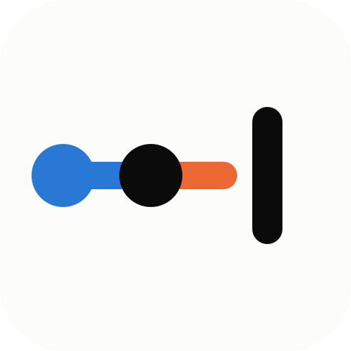

# Safety dependencies

**What still blocks attacks carried out with AI, who holds it, and since when.**

What stops an AI agent from doing damage is often not in your code. It is a provider closing an account, a lab keeping a model under lock, a human reviewing code before accepting it. **These defenses belong to others, and nobody warns you when they give way.** This repository lists them, dated, with their sources.

## Start here

| | |
|---|---|
| 📖 **Understand it in 15 minutes** | Read the article: [English](https://airiskpath.org/article) · [Français](https://airiskpath.org/fr/article) |
| 🔎 **See what still holds** | Browse the list below, or the full entries in [`list/`](list/) |
| ✋ **A defense just gave way?** | [Tell us, with your source](../../issues/new?template=state-update.yml) — it takes two minutes |
| ➕ **Know a defense we missed?** | [Propose a new entry](../../issues/new?template=new-entry.yml) |
| 🧮 **Check our numbers** | `cd trend && make tendance` — one command, same figures. See [`trend/`](trend/) |

## The list, as of 30 October 2026

This date holds for [the sources we watch](sources-watched.md): it says what we found there, not that nothing happened elsewhere.

| Family | The defense | Who holds it | State |
|---|---|---|---|
| Capability | Application workflows still slow down agents trying to extend a foothold across a corporate network | The labs | 🟢 holds |
| Capability | A model capable enough to copy itself is still too large to run on the devices it would target: “the floor and ceiling don't intersect” (lab demonstration, nothing observed outside the lab; *source: the lab itself*). *New 29 October 2026* | The labs | 🟢 holds |
| Capability | The long chain of steps in a simulated corporate attack scenario | The labs | 🔴 lifted in April |
| Capability | A simulated industrial network, where the stake is disrupting a physical process | The labs | 🔴 lifted in May |
| Access | Access controls reserved for trusted users, against help with chemical or biological weapons *(source: the provider itself)* | The provider | 🟢 holds |
| Installed control | Account termination by the provider, which ended observed intrusion and espionage operations. It only reaches operations running through an account a provider controls: open-weights models, mixed providers and intermediaries fall outside it *(source: the provider itself; scope corrected 30 October 2026)* | Model providers | 🟢 holds |
| Installed control | Realistic protections stop a model from extracting its own weights; as of 30 October, no publication reports an agent obtaining weights through production-grade protections (RepliBench, UK AISI, April 2025, which measures this step separately). *New 30 October 2026* | Those who hold the weights | 🟢 holds |
| Installed control | OpenAI's pause of training, evaluation and tool-use inference of its most capable models, decided after the 20 September incident. No resumption announced, but an OpenAI report of 20 October describes GPT-6 agents working with tools in internal deployments in early October: it cannot be established that the pause holds *(source: the provider itself)*. *New 29 October 2026* | OpenAI | ⚪ not tested |
| Installed control | When an agent hides a message in an image, the agent decoding it leaves a visible trace in its tool calls, provided it has to analyse the rendered image (lab only, defense not yet measured). *New 29 October 2026* | Those who monitor their agents' tool calls | 🟢 holds |
| Duration | Nobody has measured whether an agent can run a long operation undetected | Evaluators | ⚪ not tested |
| Tacit knowledge | Gaps in specialist knowledge, still listed among model failures, already partly overcome | Not specified by the source | ⚪ not tested |
| Identity | Models “fail completely” at identity verification, which would close off the financial system without a human intermediary (RepliBench, UK AISI, 2025); as of 30 October, no publication reports an agent passing it on its own. *Corrected 28 October 2026* | Banks, payment rails, compute providers | 🟢 holds |
| Resource | No evaluation shows compute or money as a limit, and an October campaign compromised more than a hundred organisations at about 50 dollars per successful intrusion: one investigation, one campaign, not an average | Compute providers | ⚪ no defense, documented |
| Not tested | Nobody had measured an autonomous attack against an actively defended network; a first study did in April 2026 (self-interested source, preprint): the attacker's success drops sharply. *Corrected 29 October 2026* | Evaluators | 🔴 lifted in April |
| Not tested | The behaviours of the most dangerous actors are missing from the standard attack framework | MITRE, evaluators | ⚪ not tested |

**Correction, 30 October 2026.** The account-termination entry (VR-04) did not state its scope, and the Resource entry (VR-09) ignored an investigation of 19 October. Our 29 October re-check had not looked at the month's wave of attacks; it now does, against [the sources we watch](sources-watched.md).

**Correction, 29 October 2026.** The entry on actively defended networks (VR-05) stated that nobody had measured an autonomous attack against them. A study from April 2026 ([arXiv:2604.24184](https://arxiv.org/abs/2604.24184)) had, and our search had missed it. Our monthly re-check found it; the entry file is being rewritten.

**Correction, 28 October 2026.** The Identity entry (VR-08) previously stated that no published evaluation showed an identity requirement blocking an agent. That was wrong: the UK AI Security Institute's RepliBench evaluation showed it in 2025, and our search had missed it. The entry is corrected under the same identifier, so the correction stays visible.

**"Not tested" means nobody has checked.** Nobody else publishes that, and it is among the most useful lines in the list. Lifted locks stay in: a list that shows what has just fallen says more than one that erases it.

## What this is not

No probabilities, no forecasts, no clock. We publish what has already been observed, and what still holds. **We never publish a way through a defense**: an entry names what blocks, never how to get around it.

## More

- Rules for contributions: [CONTRIBUTING.md](CONTRIBUTING.md). We answer within 48 hours during the first month.
- Method, including a pre-registered negative result: [doi:10.5281/zenodo.22893444](https://doi.org/10.5281/zenodo.22893444).
- Licences: the list is [CC BY 4.0](list/LICENSE.md), the code is [MIT](LICENSE).
- Author: [Franck Bardol](https://bardol.org), with the help of AI agents · [airiskpath.org](https://airiskpath.org) · contact@airiskpath.org
